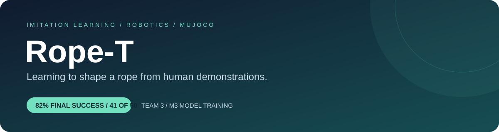
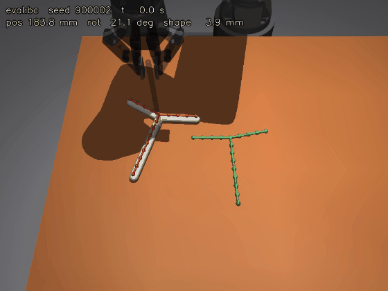
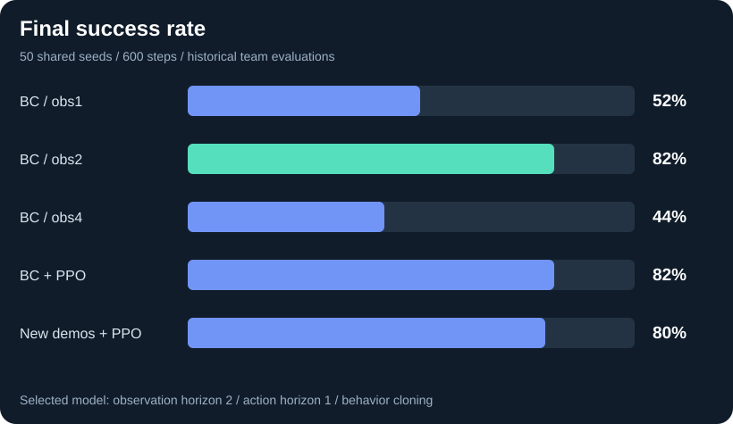
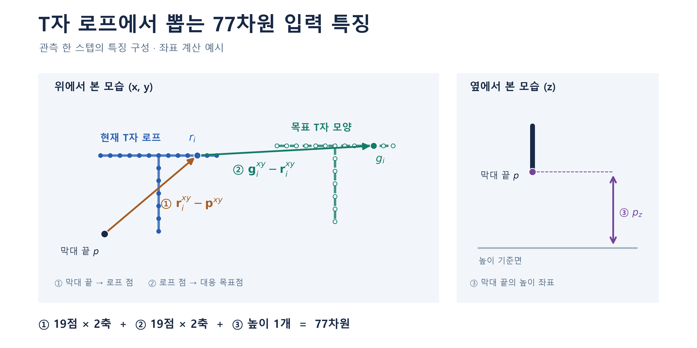
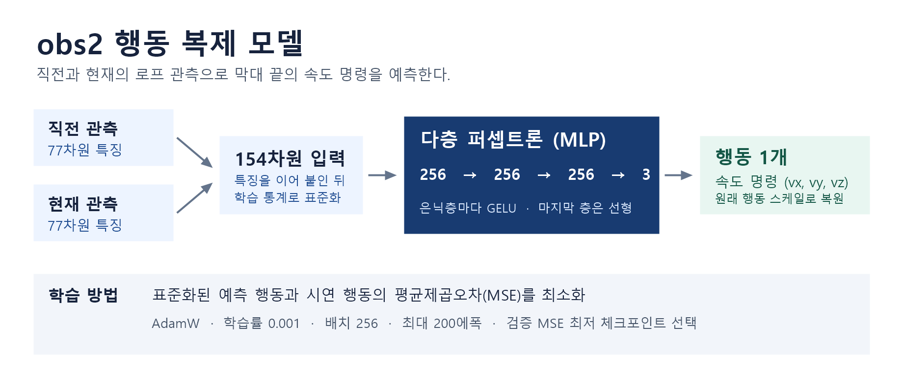
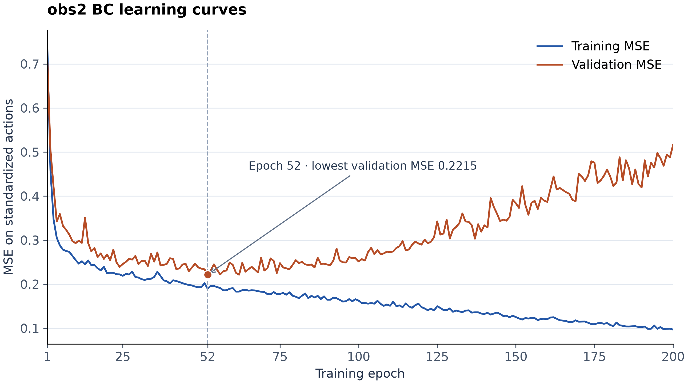
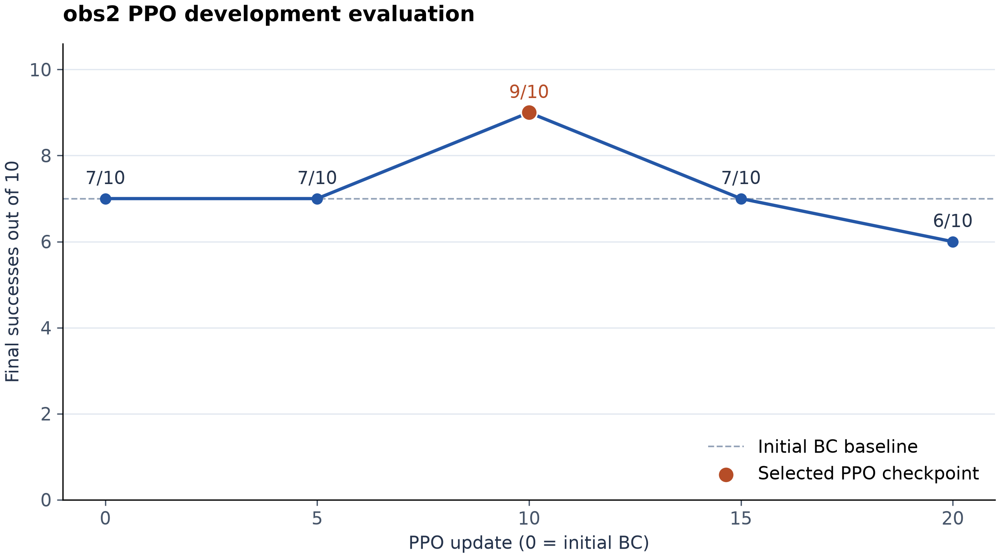

<div align="center">



<br />


**사람의 시연에서 로프 조작 행동을 학습하고, 입력의 시간 정보가 성능에 미치는 영향을 비교합니다.**

[Demo](#demo) · [Results](#results) · [Method](#method) · [Quick Start](#quick-start) · [My Contribution](#my-contribution)

</div>

<br />

| **82% · Final success** | **+30%p · vs. obs1** | **73 · Demonstrations** |
|:---:|:---:|:---:|
| 공통 평가 50회 중 41회 성공 | 관측 창 1 → 2 비교 | 학습 58 / 검증 15 에피소드 |

## Demo

<div align="center">



<sub>Episode 900002 · 기존 BC 실행 영상 · 약 5배속</sub>

</div>

로봇의 막대 끝을 움직여 로프를 목표 T 모양에 정렬합니다. 입력은 이미지 대신 **로프·목표·막대 끝의 위치 정보**, 출력은 **3차원 속도 명령**입니다. 위 영상은 동작 예시입니다. 

## Results

**관측 창 2 · 행동 창 1의 MLP 행동 복제 모델을 최종 선택했습니다.**

<div align="center">



</div>

| 정책 | 관측 창 | 최종 성공 | 한 번 이상 성공 | 모양 오차 중앙값 ↓ |
|:---|:---:|---:|---:|---:|
| BC | 1 | 26/50 · 52% | 27/50 · 54% | 11.55 mm |
| **BC · Selected** | **2** | **41/50 · 82%** | **44/50 · 88%** | **3.85 mm** |
| BC | 4 | 22/50 · 44% | 29/50 · 58% | 7.95 mm |
| BC + PPO | 2 | 41/50 · 82% | 45/50 · 90% | 6.50 mm |
| New demonstrations + PPO | 2 | 40/50 · 80% | 45/50 · 90% | 6.85 mm |

공통 평가 시드 **900000–900049**, 에피소드당 최대 **600스텝**을 사용한 기존 팀 평가 결과입니다. 모양 오차는 마지막 시점 기준입니다. 관측 창 1·2·4의 BC 비교에서는 행동 창을 1로 고정했습니다.

### What changed — and what we learned

- **시간 정보를 추가했을 때:** 관측 창 1보다 2에서 최종 성공률이 30%p 높았습니다. 이전·현재 위치를 함께 입력해 변화 정보를 활용했을 가능성이 있습니다.
- **더 긴 관측 창을 사용했을 때:** 관측 창 4는 44%였습니다. 이 실험에서는 관측 이력을 늘리는 것만으로 성능이 좋아지지 않았습니다.
- **PPO를 추가했을 때:** 한 번 이상 성공은 88% → 90%였지만 최종 성공률은 82%로 같았습니다. 모양 오차도 커져 최종 모델은 BC로 유지했습니다.

[평가 비교 CSV](results/summary.csv) · [obs2 평가 기록](results/obs2_bc.json) · [실험 해석](docs/PROJECT_STORY.md)

## Method

### Relative features → temporal input → velocity control

<div align="center">



</div>

| 특징 | 의미 | 차원 |
|:---|:---|---:|
| 로프 − 막대 끝 | 막대 끝을 기준으로 한 로프 19점의 xy 위치 | 38 |
| 목표 − 로프 | 대응하는 로프 점이 목표까지 이동해야 하는 xy 변위 | 38 |
| 막대 끝 z | 막대 끝의 높이 | 1 |
| **스텝당 합계** | **위치 관계 중심의 특징 벡터** | **77** |

최종 정책은 **이전·현재 특징을 연결한 154차원 입력**을 받아 막대 끝의 속도 명령 `(vx, vy, vz)`를 예측합니다.

<div align="center">



</div>

<details>
<summary><b>Training configuration</b></summary>

| 항목 | 설정 |
|:---|:---|
| MLP | 은닉층 256 × 3, GELU |
| 입력 / 출력 | 154 / 3 |
| Optimizer | AdamW · lr 0.001 · weight decay 0.0001 |
| Batch / Epochs | 256 / 200 |
| Loss | 표준화된 행동의 MSE |
| Model selection | 검증 손실이 가장 낮은 체크포인트 |
| Split | 에피소드 단위, 학습 58 / 검증 15 |
| Samples | 학습 14,422 / 검증 3,623 |
| Training seed | 0 |

[학습 설정 JSON](results/obs2_training_config.json) · [학습 로그 CSV](results/obs2_train_log.csv)

</details>

<details>
<summary><b>Learning curve & PPO development results</b></summary>





PPO 개발 시드 결과와 위의 최종 50회 평가는 서로 다른 평가입니다.

</details>

## Quick Start

**Anaconda 또는 Miniconda 설치 후, Windows의 Anaconda Prompt에서 실행합니다.**

### 1. Python 3.12 환경 생성

```bat
conda create -n ropet python=3.12 -y
conda activate ropet
```

### 2. 프로젝트 폴더 이동 및 패키지 설치

아래 경로를 내려받은 프로젝트의 실제 위치로 바꿉니다.

```bat
cd /d "C:\경로\RopeT_Portfolio"
python -m pip install -r requirements.txt
```

`environment.yml`을 이용한다면 환경 생성·설치를 다음 명령으로 대신할 수 있습니다.

```bat
conda env create -f environment.yml
conda activate ropet
```

### 3. BC 정책 평가

`checkpoints/obs2_bc.pt`를 준비한 후 실행합니다.

```bat
python il/eval_policy.py --agent bc --ckpt checkpoints/obs2_bc.pt --n 50 --steps 600 --out runs/eval_obs2_local
```

화면을 보며 한 에피소드만 실행하려면:

```bat
python il/eval_policy.py --agent bc --ckpt checkpoints/obs2_bc.pt --n 1 --steps 600 --view --out runs/preview_obs2
```

<details>
<summary><b>BC 재학습 / PPO 추가 실험</b></summary>

재학습에는 `demos/T03_selected_n73/ep_*.npz` 시연 73개가 필요합니다.

```bat
python il/check_il.py --data demos/T03_selected_n73
python il/train_bc.py --data demos/T03_selected_n73 --obs-horizon 2 --act-horizon 1 --seed 0 --out runs/obs2_retrain
```

PPO 추가 실험의 출력 경로는 새 폴더여야 합니다.

```bat
python il/train_rl.py --bc-ckpt checkpoints/obs2_bc.pt --out runs/obs2_ppo_new
```

</details>

> **실행 파일 안내** · 이 로컬 정리본에는 가중치와 시연이 포함되어 있지만 Git 추적에서는 제외됩니다. GitHub에서 내려받은 경우 별도 준비가 필요합니다. Python 3.12는 안내용 환경 명세이며, 해당 환경의 설치·실행을 검증한 상태는 아닙니다.

[환경 및 실행 상세](docs/ENVIRONMENT.md)

## My Contribution

**M3 · 모델 학습 구현 및 실험 분석**

| 코드 | 구현 내용 |
|:---|:---|
| [dataset.py](il/dataset.py) | 77차원 특징, 관측·행동 창, 표준화, 학습 데이터 구성 |
| [policy.py](il/policy.py) | MLP, Agent 관측 이력, 행동 스케일 복원 및 추론 |
| [train_bc.py](il/train_bc.py) | BC 학습·검증, 손실 기록, 최저 검증 손실 모델 저장 |
| [train_rl.py](il/train_rl.py) | BC 초기화 PPO 미세조정, BC 행동에서의 이탈 제한, 개발 시드 평가 |

관측 창 비교와 PPO 추가 실험을 통해 최종 모델을 선택했습니다. 시연 수집·최종 평가는 팀 공동 작업이며, 각 파일에는 제공된 인터페이스와 헬퍼 코드도 포함되어 있습니다.

<details>
<summary><b>Repository guide</b></summary>

| 경로 | 내용 |
|:---|:---|
| `il/` | 데이터 처리, 모델, BC·PPO 학습 및 평가 |
| `sim/`, `data/` | 제공된 시뮬레이터와 기준 데이터 |
| `scripts/`, `teleop.py` | 시연 수집·검사·재생·영상 도구 |
| `results/` | 평가 JSON, 학습 설정과 로그, 비교 CSV |
| `docs/images/` | 대표 GIF, 결과 그래프와 모델 그림 |
| `docs/videos/` | 원본 영상 사본 · Git 제외 |
| `checkpoints/` | 로컬 가중치 · Git 제외 |
| `demos/` | 로컬 시연 · Git 제외 |

[GitHub 업로드 안내](docs/PUBLISHING.md)

</details>

<details>
<summary><b>Evaluation & reproducibility notes</b></summary>

- 단일 학습 시드와 공통 평가 50회 결과입니다. 반복 학습 시드 간 분산은 측정하지 않았습니다.
- 로컬 가중치는 `runs/final_version/!!obs2/ckpt.pt`의 사본입니다. 과거 팀 평가 가중치와의 바이트 동일성은 확인되지 않았습니다.
- 정리 과정에서는 문법·파일 구성만 검사했으며, 학습·평가·환경 설치를 실행하지 않았습니다.
- 원본 영상의 체크포인트 정보가 없어 GIF와 평가표가 동일 가중치의 실행임을 확정하지 않습니다.

</details>

---

<div align="center">

**Sookmyung Women's University · Deep Learning · Team 3**

숙명여자대학교 기계시스템학부 심주용 교수님 제공 [과제 프레임워크](https://github.com/jooyongsim/deeplearning_SMWU_2026) 기반 프로젝트<br />
[Sources & Attribution](ATTRIBUTION.md) · [Experiment Notes](docs/PROJECT_STORY.md)

</div>
